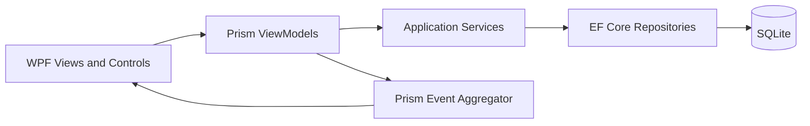

# RealTimeDrawingApplication

RealTimeDrawingApplication is a desktop collaborative drawing application built
with WPF, Prism, Entity Framework Core 3.1, and SQLite. Users can create an
account, sign in, create drawing projects, share projects, and export/import
their work.


## Features

- Account signup and login with PBKDF2-SHA256 password hashing.
- SQLite persistence created automatically on first run.
- Project and drawing-component management.
- Project sharing between accounts.
- JSON and XML import/export.
- MVVM-based WPF views with Prism commands and events.

## Architecture

The application is a small layered desktop application:



- **Views** contain XAML layout and only presentation-specific code-behind.
- **ViewModels** expose bindable state and commands to the views.
- **Application services** coordinate account, project, sharing, and file operations.
- **Infrastructure** contains the EF Core context and repository implementations.
- **Models/ProxyModel** separate persistence entities from view-facing data.
- **Security** contains password hashing and verification.

The current solution is a .NET Framework 4.7.2 WPF application. The test project
targets .NET 8 and links only to framework-independent security code so it can
run in CI without starting a WPF window or database.

## Requirements

- Windows 10/11.
- .NET Framework 4.7.2 Developer Pack.
- Visual Studio 2019/2022 with the **.NET desktop development** workload, or
  MSBuild and NuGet available on `PATH`.
- .NET 8 SDK for the unit test project.

## Installation and first run

1. Clone the repository.
2. Open `RealTimeDrawingApplication.sln` in Visual Studio.
3. Restore NuGet packages.
4. Build the solution for `Debug | Any CPU`.
5. Start `RealTimeDrawingApplication`.

The database configuration is in [`App.config`](./App.config), under the
`DrawingDatabase` connection string. This is the one place to update the
database location or provider:

```xml
<add name="DrawingDatabase"
     providerName="System.Data.SQLite"
     connectionString="Data Source={LocalAppData}\RealTimeDrawingApplication\DrawingShapeApplication.db;foreign keys=true;"/>
```

For a different location, edit only the `connectionString` value. A relative
`{LocalAppData}` is resolved automatically to the current user's local
application-data directory. This prevents a client installation under
`Program Files` from failing because the application cannot write beside its
executable. An absolute Windows path is also supported:

```xml
connectionString="Data Source=C:\Data\RealTimeDrawingApplication.db;foreign keys=true;"
```

When running a built application, edit the generated
`RealTimeDrawingApplication.exe.config` beside the executable instead of the
source `App.config`. The database directory and SQLite file are created
automatically before the login window opens. See
[docs/DATABASE-CONFIGURATION.md](./docs/DATABASE-CONFIGURATION.md) for the
complete setup and troubleshooting guide.

For command-line builds on Windows:

```powershell
nuget restore RealTimeDrawingApplication.sln
msbuild RealTimeDrawingApplication.sln /p:Configuration=Release /p:Platform="Any CPU"
dotnet test tests\RealTimeDrawingApplication.Tests\RealTimeDrawingApplication.Tests.csproj
```

## Authentication workflow

Signup validates required fields, checks for an existing email, hashes the
password with a unique random salt, stores only the resulting hash, and closes
the signup dialog. Login queries the account by email and verifies the supplied
password against the stored hash. Plaintext passwords are never persisted.

## Testing

The test project currently contains 14 unit tests covering password hashing,
salt uniqueness, malformed input, empty values, successful/failed verification,
model relationships, and JSON persistence-field exclusions. Coverage is
collected in Cobertura XML and uploaded as a GitHub Actions artifact.

The WPF application is a legacy .NET Framework executable, so not every line
can be covered by headless unit tests. Window creation, message boxes, native
file dialogs, Prism composition, and EF Core/SQLite access require UI or
integration tests. The current unit suite deliberately covers the
framework-independent security and model boundaries; database and WPF tests
should be added after extracting those dependencies behind interfaces.

The current scoped coverage gate requires at least 90% line and branch coverage
for the isolated `View.*` production code included in the test project. The
latest local run achieved 96.77% line coverage and 92.85% branch coverage.

## CI and pre-commit

GitHub Actions runs on Windows, restores the legacy NuGet packages, builds the
WPF solution, and runs the unit tests on every push to `main`/`master` and on
pull requests.

Optional local checks use [pre-commit](https://pre-commit.com/):

```powershell
pip install pre-commit
pre-commit install
pre-commit run --all-files
```

The hooks check whitespace, XML, merge conflicts, and run a no-restore build
when C#, XAML, project, or config files change. Run the initial package restore
before the build hook.

## Deployment

The GitHub Actions workflow produces a Windows ZIP artifact named
`RealTimeDrawingApplication-windows.zip` after a successful Release build. To
deploy manually:

1. Restore packages and build the solution in `Release | Any CPU`.
2. Copy the complete `bin\Release` folder, not only the `.exe`.
3. Distribute the folder or ZIP to the client.
4. Ensure the client has the .NET Framework 4.7.2 runtime.
5. Run `RealTimeDrawingApplication.exe`.

The generated `.exe.config` must stay beside the executable because it contains
the database connection string and binding redirects. The database is stored
under the current user's `%LOCALAPPDATA%` folder by default, so installation
does not require administrator write access. For a professional installer,
package this Release output with WiX Toolset, MSIX, or Inno Setup; the installer
should install the application under `Program Files` and leave user data in
`%LOCALAPPDATA%`.

The Release output also includes the SQLite native runtime at
`runtimes\win-x64\native\e_sqlite3.dll`. Keep this folder in the deployment
package; removing it causes the application to fail during database startup.

## Working with WPF in VS Code

VS Code is useful for editing, searching, Git, and command-line builds, but it
does not provide the full drag-and-drop WPF XAML designer available in Visual
Studio. For visual editing:

1. Install Visual Studio Community with the **.NET desktop development** workload.
2. Open the solution and double-click a `.xaml` file to use the designer.
3. Use the XAML preview/designer and the live visual tree while the app runs.

For a VS Code-only workflow, install the C# Dev Kit and .NET SDK, open the
repository folder, edit XAML with IntelliSense, and use the commands in the
build/test section. The application still needs Windows desktop support to run.

## Screenshots

The checked-in SVGs are lightweight documentation assets that render on GitHub
without requiring binary files. Replace them with captured PNG/GIF recordings
from the running application when a product walkthrough is available.
