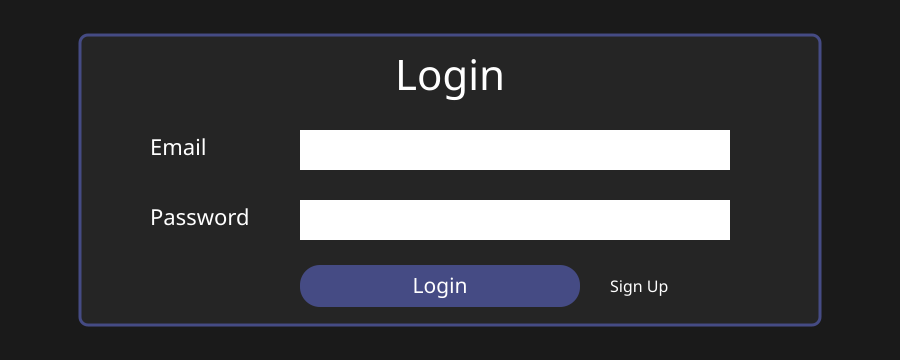
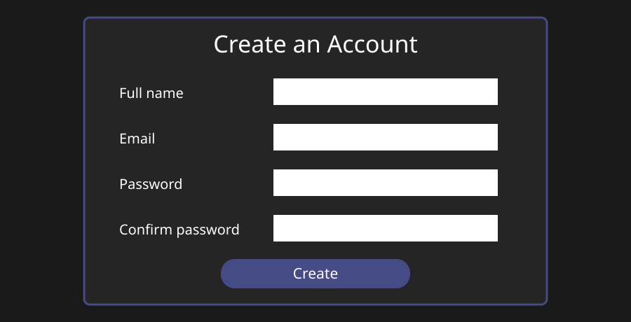
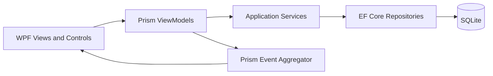
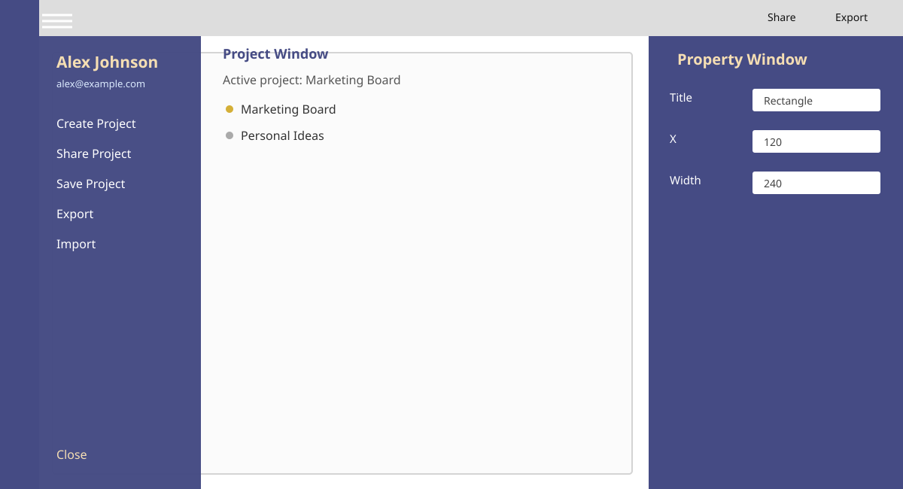
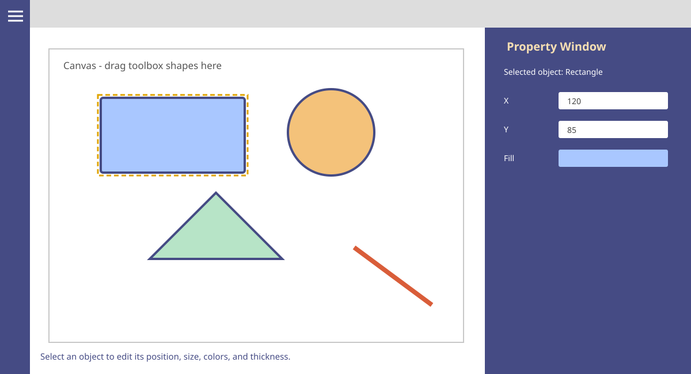
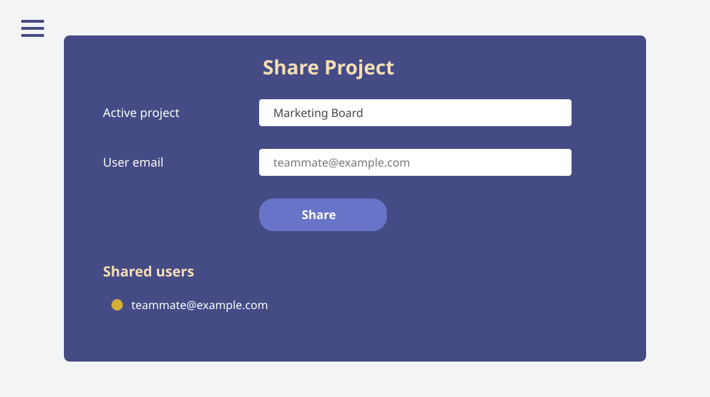

# RealTimeDrawingApplication

> **Project category:** Desktop WPF Application (C#/.NET Framework, EF Core,
> SQLite/PostgreSQL).

RealTimeDrawingApplication is a desktop collaborative drawing application built
with WPF, Prism, Entity Framework Core 3.1, and SQLite. Users can create an
account, sign in, create drawing projects, share projects, and export/import
their work.





## Purpose and usefulness

RealTimeDrawingApplication is a desktop workspace for creating, saving, and
sharing simple visual plans, diagrams, wireframes, and collaborative sketches.
It gives users a persistent canvas instead of requiring them to redraw work
each time the application is opened.

The application is useful for:

- **Planning and brainstorming:** quickly place rectangles, circles, triangles,
  lines, and text on a shared visual canvas.
- **Project-based organization:** keep separate drawings in named projects and
  switch between existing projects without losing their saved work.
- **Precise editing:** select an object and update its title, position, size,
  colors, and line or stroke thickness through the property window.
- **Sharing work:** grant another registered user access to a specific project
  by email, allowing teams to access the same persisted project data.
- **Portability:** import and export drawing components as JSON or XML for
  backup, transfer, review, or integration with other workflows.
- **Flexible deployment:** use a local SQLite database without requiring a
  server, or configure PostgreSQL for an online deployment and shared database.

The normal workflow is:

1. Create an account and sign in securely.
2. Create or select a project.
3. Draw and arrange visual objects on the canvas.
4. Edit object properties and save the project.
5. Share the project with registered users when collaboration is needed.
6. Export a copy or import an existing drawing when work needs to move between
   projects or machines.

The current collaboration model is project-based rather than a live whiteboard
session. Shared users work with the same saved project data, but the
application does not currently provide live cursors, presence indicators,
real-time change broadcasting, or automatic conflict resolution.

## Features

- Account signup and login with PBKDF2-SHA256 password hashing.
- SQLite persistence created automatically on first run.
- Project and drawing-component management.
- Project sharing between accounts.
- JSON and XML import/export.
- MVVM-based WPF views with Prism commands and events.

## Architecture

The application is a small layered desktop application:



- **Views** contain XAML layout and only presentation-specific code-behind.
- **ViewModels** expose bindable state and commands to the views.
- **Application services** coordinate account, project, sharing, and file operations.
- **Infrastructure** contains the EF Core context, repository implementations, and
  injectable account and drawing-component repository boundaries used by the
  application services.
- **Models/ProxyModel** separate persistence entities from view-facing data.
- **Security** contains password hashing and verification.

The current solution is a .NET Framework 4.7.2 WPF application. The test project
targets .NET 8 with Windows desktop support and tests framework-independent
services and mapping logic without starting a WPF window or requiring a live
database.

## Requirements

- Windows 10/11.
- .NET Framework 4.7.2 Developer Pack.
- Visual Studio 2019/2022 with the **.NET desktop development** workload, or
  MSBuild and NuGet available on `PATH`.
- .NET 8 SDK for the unit test project.
- Docker Desktop, if using the optional PostgreSQL development container.

## Installation and first run

1. Clone the repository.
2. Open `RealTimeDrawingApplication.sln` in Visual Studio.
3. Restore NuGet packages.
4. Build the solution for `Debug | Any CPU`.
5. Start `RealTimeDrawingApplication`.

The database configuration is in [`App.config`](./App.config), under the
`DrawingDatabase` connection string. This is the one place to update the
database location or provider:

```xml
<add name="DrawingDatabase"
     providerName="System.Data.SQLite"
     connectionString="Data Source={LocalAppData}\RealTimeDrawingApplication\DrawingShapeApplication.db;foreign keys=true;"/>
```

     ### Optional PostgreSQL development container

     The WPF executable runs natively on Windows and is not launched inside Docker.
     The repository includes [`docker-compose.yml`](./docker-compose.yml) to provide
     the PostgreSQL backing service for local development:

     ```powershell
     docker compose up -d postgres
     $env:REALTIME_DRAWING_POSTGRES_CONNECTION_STRING =
       "Host=localhost;Port=5432;Database=drawing;Username=drawing_app;Password=drawing_dev_password"
     ```

     Start the WPF application normally from Visual Studio, then stop the database
     when finished:

     ```powershell
     docker compose down
     ```

     The compose file is intentionally PostgreSQL-only because Docker cannot provide
     the normal Windows WPF desktop experience. SQLite remains the zero-setup
     default for users who do not need a shared database.

For a different location, edit only the `connectionString` value. A relative
`{LocalAppData}` is resolved automatically to the current user's local
application-data directory. This prevents a client installation under
`Program Files` from failing because the application cannot write beside its
executable. An absolute Windows path is also supported:

```xml
connectionString="Data Source=C:\Data\RealTimeDrawingApplication.db;foreign keys=true;"
```

When running a built application, edit the generated
`RealTimeDrawingApplication.exe.config` beside the executable instead of the
source `App.config`. The database directory and SQLite file are created
automatically before the login window opens. See
[docs/DATABASE-CONFIGURATION.md](./docs/DATABASE-CONFIGURATION.md) for the
complete setup and troubleshooting guide.

### Optional online PostgreSQL

Add a reachable PostgreSQL connection string to `OnlineDatabase` in
`App.config`, or to `RealTimeDrawingApplication.exe.config` beside a deployed
executable:

```xml
<add name="OnlineDatabase" providerName="Npgsql"
     connectionString="Host=localhost;Port=5432;Database=drawing;Username=app;Password=change-me;Timeout=3" />
```

For deployment, prefer the environment variable
`REALTIME_DRAWING_POSTGRES_CONNECTION_STRING`. It takes precedence over the
`OnlineDatabase` config value, so production credentials do not need to be
written into the deployed `.exe.config`.

PowerShell for the current process:

```powershell
$env:REALTIME_DRAWING_POSTGRES_CONNECTION_STRING = "Host=localhost;Port=5432;Database=drawing;Username=app;Password=change-me;Timeout=3"
.\bin\Release\RealTimeDrawingApplication.exe
```

Persist it for the current Windows user:

```powershell
[Environment]::SetEnvironmentVariable(
  "REALTIME_DRAWING_POSTGRES_CONNECTION_STRING",
  "Host=localhost;Port=5432;Database=drawing;Username=app;Password=change-me;Timeout=3",
  "User")
```

[`/.env.example`](./.env.example) contains a safe deployment template. The
application does not automatically load `.env` files; the installer,
deployment script, service wrapper, or operating system must set the
environment variable. Never commit a real `.env` file or production password.

The application checks this connection when creating a context. A reachable
online database is preferred; an empty or unavailable online connection falls
back to the configured SQLite database. Keep production credentials out of
source control.

The PostgreSQL tables are defined in
[`database/postgresql-schema.sql`](./database/postgresql-schema.sql). Run it
against a PostgreSQL database when you want to provision the server manually.
For a new database, the application also creates the tables automatically at
startup through EF Core `EnsureCreated()`. This project does not currently
contain EF migration files or a migration history table; schema changes to
existing production databases should therefore be handled with a reviewed,
versioned database script before deployment.

## Using the application

This section describes the normal user journey from account creation to
project collaboration.

### 1. Sign up and log in

Start the application and choose **Sign up** from the login screen. Enter a
name, email, password, and confirmation. After the account is created, log in
with the same email and password. Passwords are stored as PBKDF2-SHA256 hashes;
the original password is never saved.


### 2. Create and select a project

After login, the **Project Window** opens first. Open the navigation pane with
the hamburger button, then choose **Create Project**. Enter a project name and
select **Create**. The project list shows all projects owned by the account,
and the active project is shown at the top.

Select an existing project to make it active. Its saved drawing components are
loaded onto the canvas. The navigation pane can be closed with **Close**, the
hamburger button, or by clicking outside the pane.



### 3. Draw on the canvas

The vertical toolbar on the left contains the drawing tools. Use the shape
buttons for rectangles, ellipses, triangles, lines, and text. Drag a tool onto
the white canvas to create an object. New objects can be moved by dragging
them, and selecting an object activates the **Property Window**.

The property editor lets you adjust values such as:

- Title
- X and Y position
- Width and height
- Fill and stroke colors
- Stroke and line thickness

Changes are reflected on the selected object. Use **Save Project** from the
navigation pane to persist the current canvas to the active project.



### 4. Import and export drawings

Use the export control or the navigation pane's **Export** command to choose
JSON or XML. Export is available only when the active project contains at
least one drawing object. This prevents empty or invalid drawing files.

Use **Import** to load a JSON or XML drawing file onto the canvas. Review the
imported objects, select the active project, and save the project when the
canvas is ready.

### 5. Share a project with users

Choose the add-user icon in the top-right toolbar or choose **Share Project**
from the navigation pane. An active project is required. Enter the email
address of another registered account and choose **Share**.

The recipient is then shown in the shared-user list for the project. Sharing
is scoped to the selected project, so the same user can be shared on one
project without being added to every project.



### 6. Collaboration model

The current application provides project-based collaboration: users share
access to a project and its persisted drawing data through the configured
database. It does not currently provide live, simultaneous cursor movement or
real-time conflict resolution. For online deployments, configure PostgreSQL
using the instructions above; for offline deployments, SQLite is used.

When multiple users edit the same project, save changes deliberately and
establish a team convention to avoid overwriting one another's latest saved
version. Real-time synchronization, optimistic concurrency, and presence
indicators would be a later enhancement.

### 7. Save, sign out, and recover

Save regularly while drawing. Sign out from the navigation pane to return to
the login screen. If the application cannot connect to PostgreSQL, it falls
back to SQLite when the local database is available. If startup fails, check
the connection configuration and the SQLite native runtime file under
`runtimes\win-x64\native`.

For command-line builds on Windows:

```powershell
nuget restore RealTimeDrawingApplication.sln
msbuild RealTimeDrawingApplication.sln /p:Configuration=Release /p:Platform="Any CPU"
dotnet restore tests\RealTimeDrawingApplication.Tests\RealTimeDrawingApplication.Tests.csproj
dotnet test tests\RealTimeDrawingApplication.Tests\RealTimeDrawingApplication.Tests.csproj --no-restore
```

`nuget restore` is required for the legacy WPF project because it uses
`packages.config`. The SDK-style test project has a committed
`packages.lock.json`; use `--locked-mode` in CI or when you need to verify
reproducible test dependencies. The WPF project cannot use an SDK-style
NuGet lock file without being migrated from `packages.config`.

### Fresh-clone verification

From a new clone on Windows:

1. Install the .NET Framework 4.7.2 Developer Pack, Visual Studio with the
   **.NET desktop development** workload, and the .NET 8 SDK.
2. Ensure `nuget.exe` and Visual Studio `msbuild.exe` are available, or run the
   commands from a Visual Studio Developer PowerShell.
3. Run:

   ```powershell
   nuget restore RealTimeDrawingApplication.sln
   msbuild RealTimeDrawingApplication.sln /p:Configuration=Release /p:Platform="Any CPU"
   dotnet restore tests\RealTimeDrawingApplication.Tests\RealTimeDrawingApplication.Tests.csproj --locked-mode
   dotnet test tests\RealTimeDrawingApplication.Tests\RealTimeDrawingApplication.Tests.csproj --no-restore
   ```

4. Start `bin\Release\RealTimeDrawingApplication.exe`.

The application creates the default SQLite database under
`%LOCALAPPDATA%\RealTimeDrawingApplication` during first startup. No external
database is required for the default local workflow.

## Authentication workflow

Signup validates required fields, checks for an existing email, hashes the
password with a unique random salt, stores only the resulting hash, and closes
the signup dialog. Login queries the account by email and verifies the supplied
password against the stored hash. Plaintext passwords are never persisted.

## Testing

The test project currently contains 44 unit tests covering password hashing,
salt uniqueness, malformed input, empty values, successful/failed verification,
model relationships, and JSON persistence-field exclusions. Coverage is
collected in Cobertura XML, checked against a 40% minimum line-coverage gate,
and uploaded as a GitHub Actions artifact. The CI workflow also runs
`git diff --check` as a lint step.

The WPF application is a legacy .NET Framework executable, so not every line
can be covered by headless unit tests. Window creation, message boxes, native
file dialogs, Prism composition, and EF Core/SQLite access require UI or
integration tests. The current unit suite deliberately covers the
framework-independent security, service, mapping, and ViewModel boundaries;
database and direct WPF-window tests should be added after extracting those
dependencies behind interfaces.

The current scoped coverage gate requires at least 90% line and branch coverage
for the isolated `View.*` production code included in the test project. The
latest local run achieved 96.77% line coverage and 92.85% branch coverage.

## CI and pre-commit

GitHub Actions runs on Windows, restores the legacy NuGet packages, builds the
WPF solution, and runs the unit tests on every push to `main`/`master` and on
pull requests.

Optional local checks use [pre-commit](https://pre-commit.com/):

```powershell
pip install pre-commit
pre-commit install
pre-commit run --all-files
```

The hooks check whitespace, XML, and merge conflicts. The full WPF build and
test run is performed by GitHub Actions on a Windows runner.

## Deployment

The GitHub Actions workflow produces a Windows ZIP artifact named
`RealTimeDrawingApplication-windows.zip` after a successful Release build. To
deploy manually:

1. Restore packages and build the solution in `Release | Any CPU`.
2. Copy the complete `bin\Release` folder, not only the `.exe`.
3. Distribute the folder or ZIP to the client.
4. Ensure the client has the .NET Framework 4.7.2 runtime.
5. Run `RealTimeDrawingApplication.exe`.

The generated `.exe.config` must stay beside the executable because it contains
the database connection string and binding redirects. The database is stored
under the current user's `%LOCALAPPDATA%` folder by default, so installation
does not require administrator write access. For a professional installer,
package this Release output with WiX Toolset, MSIX, or Inno Setup; the installer
should install the application under `Program Files` and leave user data in
`%LOCALAPPDATA%`.

The Release output also includes the SQLite native runtime at
`runtimes\win-x64\native\e_sqlite3.dll`. Keep this folder in the deployment
package; removing it causes the application to fail during database startup.

### Publishing a downloadable GitHub release

The repository includes a release workflow at
[`.github/workflows/release.yml`](./.github/workflows/release.yml). It builds
and tests the application on Windows, packages the complete Release output,
and publishes a GitHub Release containing:

```text
RealTimeDrawingApplication-windows.zip
```

To publish version `1.0.0`:

```powershell
git tag v1.0.0
git push origin v1.0.0
```

GitHub Actions then creates the release automatically. A laptop user downloads
the ZIP, extracts the complete folder, confirms that .NET Framework 4.7.2 or
later is installed, and starts `RealTimeDrawingApplication.exe`.

The ZIP is a portable application package, not an MSI installer. It does not
require administrator permissions when extracted to a user-writable folder.
For a Start Menu shortcut, uninstall support, or enterprise deployment, use
the same Release folder as input to an installer tool such as Inno Setup,
WiX, or MSIX. Keep the executable, `.exe.config`, all managed DLLs, and
`runtimes\win-x64\native\e_sqlite3.dll` together.

## Working with WPF in VS Code

VS Code is useful for editing, searching, Git, and command-line builds, but it
does not provide the full drag-and-drop WPF XAML designer available in Visual
Studio. For visual editing:

1. Install Visual Studio Community with the **.NET desktop development** workload.
2. Open the solution and double-click a `.xaml` file to use the designer.
3. Use the XAML preview/designer and the live visual tree while the app runs.

For a VS Code-only workflow, install the C# Dev Kit and .NET SDK, open the
repository folder, edit XAML with IntelliSense, and use the commands in the
build/test section. The application still needs Windows desktop support to run.

## Screenshots

The checked-in SVGs are lightweight documentation assets that render on GitHub
without requiring binary files. Replace them with captured PNG/GIF recordings
from the running application when a product walkthrough is available.
